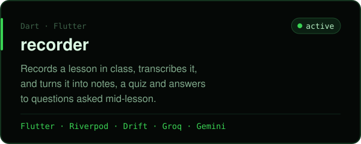
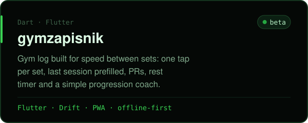
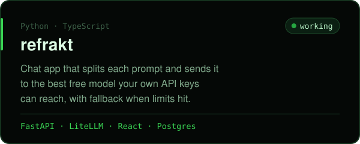
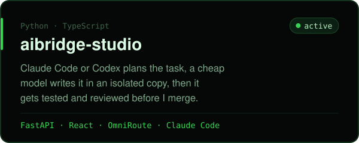
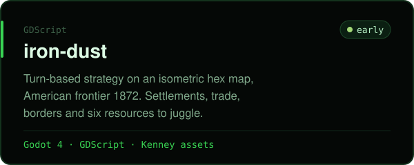
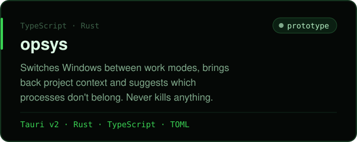
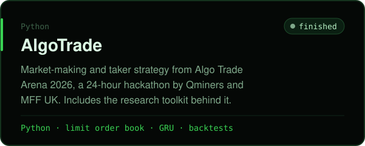
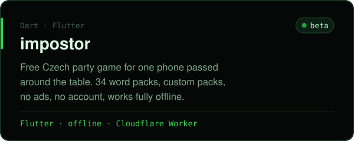

Hi, I'm Tomáš. I'm in high school in Czechia, and most of what's on this account started as
a problem I had myself: taking notes in class, logging sets at the gym, running out of free
API quota halfway through something.

This year I won the Czech selection for the International Olympiad in Artificial Intelligence
and competed for Czechia at **IOAI 2026** in Astana.

Lately I also build AI dev tooling: small systems that let
coding agents plan, hand off and check each other's work.


### things I'm building

<a href="https://github.com/radys-s/recorder"></a>
<a href="https://github.com/radys-s/gymzapisnik"></a>
<a href="https://github.com/radys-s/refrakt"></a>
<a href="https://github.com/radys-s/aibridge-studio"></a>
<a href="https://github.com/radys-s/iron-dust"></a>
<a href="https://github.com/radys-s/opsys"></a>
<a href="https://github.com/radys-s/AlgoTrade"></a>
<a href="https://github.com/radys-s/impostor"></a>

Smaller ones: [growthOS](https://github.com/radys-s/growthOS) ranks competitions and internships
by how much they'd actually help, [aibridge](https://github.com/radys-s/aibridge) is a memory layer
for coding agents, [athlete-os](https://github.com/radys-s/athlete-os) is the gym tracker that
gymzapisnik grew out of, and my [t3code fork](https://github.com/radys-s/t3code) adds automatic
model routing to T3 Code.

<!-- activity:start -->
### latest releases

- **recorder** [Aftermind 1.0.0 (build 3)](https://github.com/radys-s/recorder/releases/tag/v1.0.0) · 2026-11-14
- **impostor** [1.0.0](https://github.com/radys-s/impostor/releases/tag/v1.0.0) · 2026-11-14
- **aibridge-studio** [v0.5.0](https://github.com/radys-s/aibridge-studio/releases/tag/v0.5.0) · 2026-11-14
- **gymzapisnik** [1.0.0 beta 12](https://github.com/radys-s/gymzapisnik/releases/tag/v1.0.0-beta.12) (pre-release) · 2026-11-14
- **opsys** [v0.1.0](https://github.com/radys-s/opsys/releases/tag/v0.1.0) (pre-release) · 2026-11-14

### recently worked on

- [stonetown-navrhy](https://github.com/radys-s/stonetown-navrhy) · Ukázkové návrhy webu (demo, ne oficiální stránky)
- [refrakt](https://github.com/radys-s/refrakt) · Chat app that routes each prompt across free LLM APIs using your own keys. FastAPI + React.
- [gymzapisnik](https://github.com/radys-s/gymzapisnik) · Offline-first gym log in Czech: fast set entry, PRs, split templates, progression coach. Flutter.
- [aibridge-studio](https://github.com/radys-s/aibridge-studio) · Plan with Claude Code or Codex, implement with a cheap model, verify and review the diff.
- [growthOS](https://github.com/radys-s/growthOS) · Ranks competitions, internships and projects by how much they move my profile toward a goal.
<!-- activity:end -->

### what I use

```
daily      Python, Dart/Flutter, TypeScript, React, FastAPI, SQLite / Postgres
sometimes  Rust (Tauri), Godot, Next.js, Supabase
ml         classical ML and deep learning, mostly from olympiad work
around it  Claude Code, Codex, git, a lot of Obsidian notes
```


<picture>
  
</picture>
