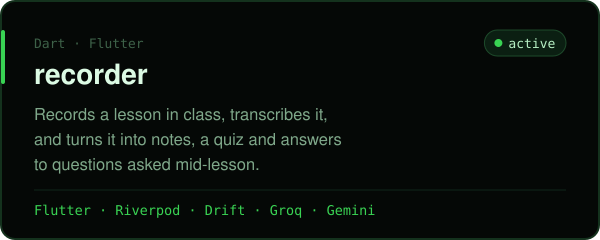
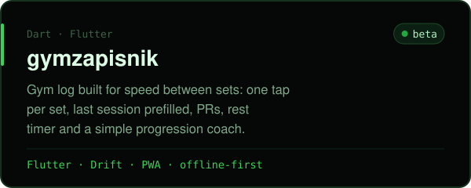
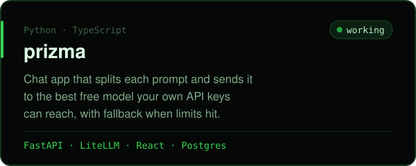
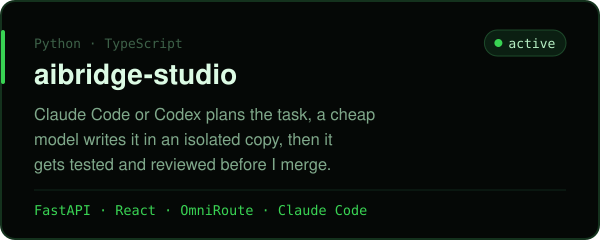
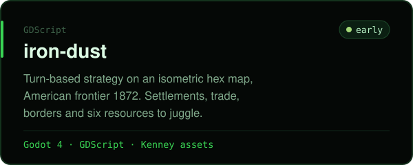
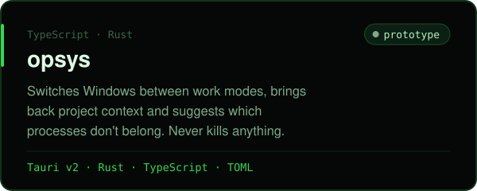

Hi, I'm Tomáš. I'm in high school in Czechia, and most of what's on this account started as
a problem I had myself: taking notes in class, logging sets at the gym, running out of free
API quota halfway through something.

This year I won the Czech selection for the International Olympiad in Artificial Intelligence
and competed for Czechia at **IOAI 2026** in Astana.

Lately I also build AI dev tooling: small systems that let
coding agents plan, hand off and check each other's work.


### things I'm building

<a href="https://github.com/radys-s/recorder"></a>
<a href="https://github.com/radys-s/gymzapisnik"></a>
<a href="https://github.com/radys-s/prizma"></a>
<a href="https://github.com/radys-s/aibridge-studio"></a>
<a href="https://github.com/radys-s/iron-dust"></a>
<a href="https://github.com/radys-s/opsys"></a>

Smaller ones: [growthOS](https://github.com/radys-s/growthOS) ranks competitions and internships
by how much they'd actually help, [aibridge](https://github.com/radys-s/aibridge) is a memory layer
for coding agents.

### what I use

```
daily      Python, Dart/Flutter, TypeScript, React, FastAPI, SQLite / Postgres
sometimes  Rust (Tauri), Godot, Next.js, Supabase
ml         classical ML and deep learning, mostly from olympiad work
around it  Claude Code, Codex, git, a lot of Obsidian notes
```


<picture>
  
</picture>
